<!-- GALACTIC-SHOWCASE: this file is replaced by templates/profile.md the first time the workflow runs in your profile repo. -->

# Galactic Profile

**An animated sci-fi GitHub profile README that rebuilds itself every day.**
A floating city grows one tower for every day you contribute. No servers, no tokens to set up, no JavaScript: just SVGs and a GitHub Action.

[**Use this template →**](https://github.com/new?template_name=galactic-profile&template_owner=adityavdn) &nbsp;·&nbsp; [Live example](https://github.com/adityavdn) &nbsp;·&nbsp; [Setup in 2 minutes](#setup-in-2-minutes)

## What you get

Every image below is generated from your GitHub data and refreshed daily at 03:17 UTC.

| | |
|---|---|
| **Hyperspace hero** | Your name drops out of a jump to lightspeed, with streaking stars. |
| **Opening crawl** | Your story scrolling into deep space, in true perspective. |
| **Contribution city** | One tower per active day, sized by how much you shipped. Towers rise in a ripple from a random point each day, then sway like water. |
| **Operations readout** | Total contributions, active days, busiest day, current and longest streak, weekly activity bars. |
| **Language hologram** | Languages ranked by how many of your public repos use them. |
| **Transmission log** | Your latest public activity: pushes, new repos, PRs, releases. |
| **Stack console** | Your tools with brand icons, picked in `profile.json`. |
| **Mission files** | A card for each pinned repo. Pin a new repo and its card appears on the next build. |
| **Saber dividers and footer** | Little touches that ignite, hum and fly by. |

## Setup in 2 minutes

1. Click [**Use this template**](https://github.com/new?template_name=galactic-profile&template_owner=adityavdn) and name the new repository **exactly your username** (that makes it your profile README). Keep it public.
2. Open the **Actions** tab of the new repo and click **Run workflow** on *Build galactic profile*.
3. Wait about a minute. Your profile now shows the full layout, and it rebuilds itself every day.

That's it. Your username, name, bio and location are read from your GitHub profile, and your pinned repos become mission files automatically.

> If the run fails with a permissions error: **Settings → Actions → General → Workflow permissions → Read and write permissions**, then run it again.

## Make it yours

Everything lives in [`profile.json`](profile.json). Blank fields are filled in from GitHub.

| Field | What it does |
|---|---|
| `user` | GitHub username. Blank means the repo owner. |
| `name`, `role`, `tagline` | Hero text. Blank uses your GitHub name, bio and location. |
| `skills` | Rows of the stack console: `["Label", "simple-icons-slug"]`. Add any icon SVG from [simple-icons](https://simpleicons.org) to `assets/icons/`. |
| `crawl` | Lines of the opening crawl. Kinds: `episode`, `title`, `body`, `gap`. |
| `fallback_repos` | Repo names to show when nothing is pinned. Blank uses your most-starred repos. |

**Bring your own art (optional):**

- `assets/hero.jpg` replaces the painted hero backdrop (1600px+ wide).
- `assets/backdrop.jpg` replaces the stack and repo-card backdrop (2000x927, with the main object centred near x=560, y=415).
- New towers, a new platform or a new space photo: put them on one white-background sheet and run `python scripts/prep_city.py sheet.png` (edit the crop boxes at the top of the script).

## How it works

- `scripts/build.py` pulls your contribution calendar, pinned repos, languages and activity from the GitHub API, then writes every SVG into `dist/`.
- The workflow force-pushes `dist/` to an `output` branch, and points the README images at that exact commit. That way GitHub's image cache never shows a stale city.
- Animation is plain CSS inside each SVG, which GitHub allows in README images. Fonts and images are embedded, so nothing loads from outside.
- Run it locally: `pip install pillow numpy`, then `GH_TOKEN=$(gh auth token) python scripts/build.py --out dist` and open the files in `dist/`.

## Credits

Built by [@adityavdn](https://github.com/adityavdn). Fonts, icons and art credits are in [NOTICE.md](NOTICE.md). Code is MIT licensed.

If this made your profile better, a ⭐ helps other people find it.
